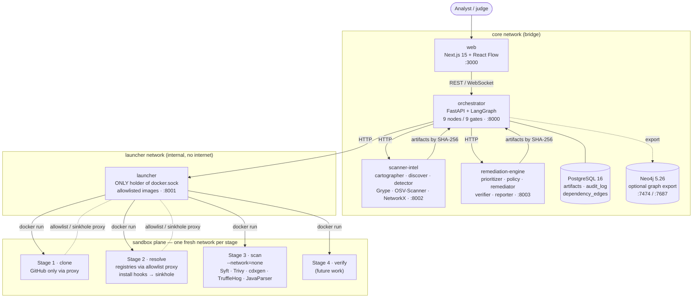
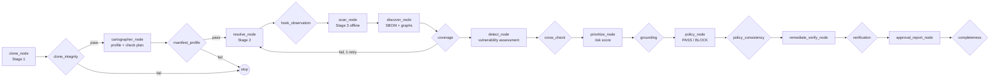
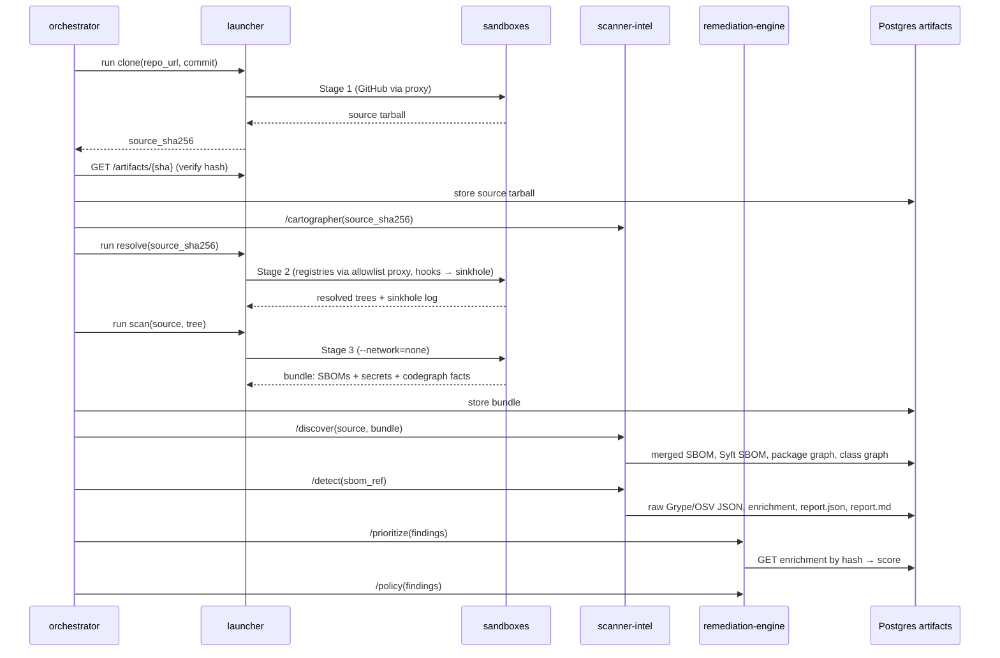
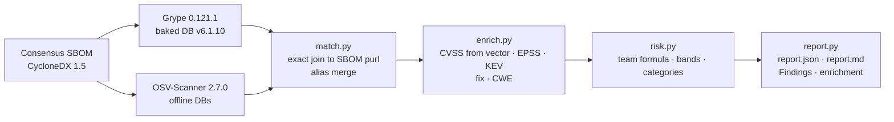

# Supply Chain Guardian — Day 1 Engineering Report

**Repository:** `github.com/Anirudh2465/BGSW-Team-22`
**Branch reported:** `feat/sbom-vulnerability-assessment` @ `7d31d83` ("feat: end of day 1")
**Report date:** 2026-11-23
**Scope:** everything built from the first commit to the end of Day 1, how it works, what was verified with real outputs, and what is still missing for the five Day 1 requirements.

> **Read this first.** `main` is still at `675c689`. Every Day 1 feature described here (dependency graph UI, SBOM artifacts, class graph, vulnerability assessment) lives on `feat/sbom-vulnerability-assessment`. Merge it, or point the judges at that branch.

### Evidence labels used in this document

| Label | Meaning |
|---|---|
| **Verified** | Ran on the local stack against a real public repository or real tool output; the output is quoted. |
| **Implemented** | Code exists and is unit-tested, but has not been observed working end to end in the pipeline. |
| **Unverified** | A claim or behaviour nobody has checked yet. Do not present it as fact. |
| **Placeholder** | Hard-coded or simulated output. Must not be presented as a real result. |

### Status at a glance

| # | Day 1 requirement | Status |
|---|---|---|
| 1 | Discover component names, versions, direct/transitive dependencies from manifests and lockfiles | ✅ **Verified** |
| 2 | Generate or consume a CycloneDX/SPDX SBOM and build a dependency graph showing component origins | ✅ **Verified** (CycloneDX only; no SPDX) |
| 3 | Inspect at least one container image or CI/CD workflow | ⚠️ **Partial** — workflows and Dockerfiles are listed, Actions are SBOM components and CVE-checked; workflow content and images are not inspected |
| 4 | Detect known vulnerabilities, including CVE, severity, available fixes and dependency paths | ✅ **Verified** |
| 5 | Detect at least one supply-chain anomaly | ❌ **Missing in the pipeline** — detectors exist and are unit-tested, but none produces a finding during a real run |

---

## Table of contents

1. [What the project is](#1-what-the-project-is)
2. [Architecture](#2-architecture)
3. [Timeline: everything done since the first commit](#3-timeline-everything-done-since-the-first-commit)
4. [Requirement 1 — Dependency discovery](#4-requirement-1--dependency-discovery)
5. [Requirement 2 — SBOM and dependency graph](#5-requirement-2--sbom-and-dependency-graph)
6. [Requirement 3 — Container image / CI-CD inspection](#6-requirement-3--container-image--ci-cd-inspection)
7. [Requirement 4 — Known vulnerability detection](#7-requirement-4--known-vulnerability-detection)
8. [Requirement 5 — Supply-chain anomaly detection](#8-requirement-5--supply-chain-anomaly-detection)
9. [How findings are presented](#9-how-findings-are-presented)
10. [Beyond Day 1: class dependency graph](#10-beyond-day-1-class-dependency-graph)
11. [Verification record](#11-verification-record)
12. [Hard-coded results and placeholders](#12-hard-coded-results-and-placeholders)
13. [Bugs found and fixed along the way](#13-bugs-found-and-fixed-along-the-way)
14. [Gaps blocking the Day 1 demonstration](#14-gaps-blocking-the-day-1-demonstration)
15. [Future work](#15-future-work)
16. [How to run and reproduce](#16-how-to-run-and-reproduce)
17. [Appendix](#17-appendix)

---

## 1. What the project is

Supply Chain Guardian answers three questions about any application repository:

1. **What is inside it?** Every third-party component, its exact version, and whether the app uses it directly or through another package.
2. **How did each component get there?** The exact chain of dependencies from the app to the component.
3. **Is it dangerous?** Known vulnerabilities (CVEs) with severity, fixes and a reproducible risk score, plus supply-chain anomalies such as malicious install scripts, typosquats and unpinned CI actions.

It is built around the team's *Rectified Architecture* document. Three design rules drive everything:

- **Untrusted code only runs in throwaway sandboxes.** Repository code is cloned, resolved and scanned inside short-lived containers that only one service (the launcher) can start.
- **Resolve with the network, scan without it.** Package managers need the internet to resolve dependencies; scanners do not. The scan stage runs with `--network=none`.
- **Code decides safety, not AI.** Every gate, score, verdict and fix candidate is computed by deterministic code. No LLM is involved in any Day 1 result.

---

## 2. Architecture

### 2.1 System overview



ASCII fallback (for viewers that do not render Mermaid):

```
                          ┌───────────────────────────┐
                          │  web (Next.js) :3000      │
                          └─────────────┬─────────────┘
                                        │ REST / WebSocket
┌───────────────────────────────────────▼───────────────────────────────────────┐
│ orchestrator :8000 — LangGraph pipeline, 9 nodes, 9 deterministic gates        │
│ artifact broker (by SHA-256) · audit chain · Neo4j export (optional)          │
└──────┬──────────────────────┬──────────────────────┬──────────────────┬────────┘
       │ launcher net         │ core net              │ core net         │
┌──────▼───────┐     ┌────────▼────────┐    ┌─────────▼────────┐  ┌──────▼──────┐
│ launcher     │     │ scanner-intel   │    │ remediation-eng. │  │ PostgreSQL  │
│ docker.sock  │     │ discover/detect │    │ prioritize/policy│  │ Neo4j (opt) │
└──────┬───────┘     └─────────────────┘    └──────────────────┘  └─────────────┘
       │ docker run (allowlisted images, fresh network per stage)
┌──────▼────────────┬──────────────────────┬────────────────────────┬────────────┐
│ 1 clone           │ 2 resolve            │ 3 scan                 │ 4 verify   │
│ GitHub via proxy  │ registries via proxy │ --network=none         │ (future)   │
│                   │ hooks → sinkhole     │ Syft/Trivy/cdxgen/...  │            │
└───────────────────┴──────────────────────┴────────────────────────┴────────────┘
              only hashed data (tarballs, trees, SBOMs, logs) moves between stages
```

### 2.2 Containers

| Container | Role | Key technology | Port |
|---|---|---|---|
| `web` | Dashboard: scans, run workspace, package graph, class graph, findings, reports | Next.js 15, React 19, React Flow 12, Tailwind, d3-force | 3000 |
| `orchestrator` | Runs the pipeline, brokers artifacts by hash, records the audit chain, exports to Neo4j | FastAPI, LangGraph, psycopg, neo4j driver | 8000 |
| `launcher` | The **only** component with the Docker socket; starts allowlisted sandbox images | FastAPI, Docker CLI, egress/sinkhole proxies | 8001 (internal only) |
| `scanner-intel` | Cartographer (repo profile + check plan), discover (SBOM + graphs), detector (vulnerability assessment) | Python, NetworkX, Grype, OSV-Scanner, `cvss` | 8002 |
| `remediation-engine` | Prioritizer (risk score), policy (PASS/BLOCK), remediator/verifier/reporter (Day 2) | Python, Jinja2 | 8003 |
| `postgres` | Artifacts (content-addressed blobs), audit log, dependency edges | PostgreSQL 16 | 5432 |
| `neo4j` (profile) | Optional graph export for ad-hoc Cypher queries | Neo4j 5.26 community | 7474 / 7687 |

### 2.3 Networks and isolation

| Network | Members | Internet |
|---|---|---|
| `core` (bridge) | web, orchestrator, scanner-intel, remediation-engine, postgres, neo4j | Yes (scanner-intel uses it for EPSS/KEV feeds) |
| `launcher` (internal) | orchestrator, launcher | **No** |
| `egress` (bridge) | launcher only | Upstream of the allowlist proxy |
| Per-stage sandbox network | one sandbox + the launcher's proxy alias | Only through the proxy (stages 1, 2) or none (stage 3) |

Sandbox hardening applied by [docker_runner.py](../services/launcher/app/docker_runner.py): read-only root filesystem, size-capped tmpfs for `/workspace` and `/tmp`, all Linux capabilities dropped, `no-new-privileges`, non-root user `10001:10001`, CPU/memory/PID limits (`SANDBOX_MEMORY=4g`, `SANDBOX_PIDS=512`), container destroyed after the stage.

> **Honest caveat.** The architecture targets gVisor (`runsc`). On the Windows 11 dev machine `.env` sets `SANDBOX_RUNTIME=runc`, i.e. the hardened-Docker fallback the architecture document allows. Say so in the demo.

### 2.4 The six invariants and where they are enforced

| # | Invariant | Enforced in |
|---|---|---|
| 1 | Resolve in Stage 2 behind an allowlist proxy; scan in Stage 3 with `--network=none` | [stage3_scan.py](../services/launcher/app/stages/stage3_scan.py) raises if `network_mode != "none"`; [allowlist.py](../services/launcher/app/allowlist.py) |
| 2 | remediate → verify → approve → open PR | [ApprovalQueue.tsx](../services/web/src/components/ApprovalQueue.tsx) locks approval until `state == "verified"` (remediation itself is Day 2) |
| 3 | Code decides safety | All gates in [nodes.py](../services/orchestrator/app/graph/nodes.py); score formula in [prioritizer.py](../services/remediation-engine/app/agents/prioritizer.py) and [risk.py](../services/scanner-intel/app/vuln/risk.py) |
| 4 | No free text crosses model boundaries | Ollama is off (`ENABLE_OLLAMA=false`); no LLM is used anywhere in Day 1 |
| 5 | Single Docker socket owner | Only `launcher` mounts `/var/run/docker.sock` in [docker-compose.yml](../docker-compose.yml) |
| 6 | Stateless stage handoff: state holds commit SHA and artifact hashes only | Every stage output is pulled by SHA-256 and hash-verified ([nodes.py `_pull`](../services/orchestrator/app/graph/nodes.py)) |

### 2.5 Pipeline: nodes and gates



| Gate | What the code checks | Day 1 reality |
|---|---|---|
| clone_integrity | Source hash, no symlink escapes, size and file-count caps | Real |
| manifest_profile | A readable profile and a non-empty, rule-built check plan | Real |
| hook_observation | Stage 2 completed and the hook-observe pass ran | Real stage check, **but passes even when the sinkhole saw CRITICAL egress** (see §8) |
| coverage | No detected ecosystem is `skipped`; 1 retry of resolve | Real |
| cross_check | The SBOM was assessed by ≥1 tool and every finding has evidence | Real (since 7d31d83) |
| grounding | Every finding has evidence and a score in 0–100 | Real; fails closed if enrichment is unreadable |
| policy_consistency | Every finding has PASS or BLOCK | Real |
| verification | Patch built and tested | **Placeholder** (Day 2) |
| completeness | Report produced | Real report hashes; content is Day 2 scope |

### 2.6 Artifact flow (everything moves by SHA-256)



### 2.7 Code map

```
BGSW/
├── packages/contracts/            Frozen shared schemas (GuardianState, Finding, Evidence, API schemas) + golden fixtures
├── services/
│   ├── launcher/                  Stages 1–4, Docker runner, egress proxy, sinkhole, sandbox images
│   │   ├── app/stages/            stage1_clone · stage2_resolve · stage3_scan · stage4_verify
│   │   └── sandbox-images/        clone/resolve/scan/verify Dockerfiles + javaparser/ClassGraphExtractor.java
│   ├── orchestrator/              LangGraph nodes and gates, artifact broker, audit chain, Neo4j export, REST API
│   ├── scanner-intel/
│   │   ├── app/agents/            cartographer · discover · detector
│   │   ├── app/sbom/              purl normalisation, parsers, SBOM merge + package graph
│   │   ├── app/codegraph/         Java class dependency graph (NetworkX)
│   │   ├── app/vuln/              SBOM vulnerability assessment (Grype, OSV-Scanner, CVSS/EPSS/KEV)
│   │   └── app/detectors/         install_hooks · squat_confusion · pinning_lockfile · agent_config
│   ├── remediation-engine/        prioritizer · policy · remediator · verifier · reporter
│   └── web/                       Next.js dashboard
├── infra/postgres/                Schema and checkpoint tables
└── tests/                         eval_runner.py, golden repo, 5 red-team repos
```

---

## 3. Timeline: everything done since the first commit

| Commit | When (2026-11-23) | Author | Summary | Size |
|---|---|---|---|---|
| `89cbd88` | 14:58 | Anirudh2465 | Monorepo scaffold: 5 services, frozen contracts, fixtures, red-team repos, eval runner | 112 files, +5,049 |
| `5316fdb` | 15:51 | Vijay Santhosh P | Real discovery pipeline up to the dependency graph | 40 files, +3,713 / −471 |
| `af24596` | 16:17 | Vijay Santhosh P | Neo4j export and working React Flow dashboard | 20 files, +3,396 / −85 |
| `3d9630c` | 16:58 | Anirudh2465 | Removed superseded UI components | 3 files, −437 |
| `3d81936` | 16:58 | Anirudh2465 | Dashboard redesign + graph explorer; launcher `docker-cli` fix | 29 files, +3,456 / −423 |
| `7d31d83` | 18:15 | Anirudh2465 | Separate SBOM/package/class graph artifacts, JavaParser class graph, vulnerability assessment, pipeline wiring | 51 files, +25,517 / −74 |

`main` also carries three small fixes (`481898d`, `b5654ff`, `675c689`: web build fixes and the launcher `docker-cli` package) that were made on the original branch. The feature branch re-applied the `docker-cli` fix and superseded the web fixes with the redesigned build.

### Phase 0 — Scaffold (`89cbd88`)
- Monorepo with five services and a shared, frozen `guardian_contracts` package (`GuardianState`, `Finding`, `Evidence`, `Remediation`, `Approval`, all API request/response schemas).
- Golden fixtures (`log4shell_findings.json`, `stage1..4_*.json`), a Log4Shell golden repo, and five red-team repos (prompt-injection README, malicious postinstall, symlink escape, oversize repo, fake-package comment).
- `tests/eval_runner.py`: 4 golden + 5 red-team checks against the detector and policy modules.
- `docker-compose.yml`, `Makefile`, root and per-service `CLAUDE.md` rules.

### Phase 1 — Real discovery pipeline (`5316fdb`)
- **Launcher stages made real.** Stage 1 hardened clone (`--depth 1`, no submodules, `core.symlinks=false`, caps, deterministic tar normalisation). Stage 2 resolution behind an allowlist proxy plus a hook-observe pass routed to a sinkhole. Stage 3 offline scan with Syft, Trivy, cdxgen and TruffleHog (secrets redacted before leaving the sandbox).
- **Artifact broker.** The orchestrator pulls every stage output from the launcher by SHA-256, verifies it and stores it in Postgres.
- **Discover agent.** Parsers for Maven trees, `npm ls`, npm lockfiles, pip reports, `uv.lock`, `poetry.lock`; SBOM consensus merge by normalised purl; NetworkX dependency graph with depth, direct flag and shortest path; coverage gate.

### Phase 2 — Graph visualisation (`af24596`)
- Optional Neo4j export of each run's graph, run-scoped, with ready-made Cypher queries and Browser links.
- First React Flow dependency graph in the dashboard.

### Phase 3 — Dashboard redesign (`3d9630c`, `3d81936`)
- Tabbed run workspace: Overview, Package graph, Findings, Remediation, Pipeline, Reports; graph can open in its own browser tab.
- Graph explorer: All / Explore / Focus views; layered, radial and force layouts; colour by ecosystem, risk, depth or source corroboration; search; filters (depth, direct only, vulnerable paths, single-source, scanner-only, ecosystem); inspector with dependents, dependencies, blast radius, number of paths from the app; Cypher copy / open in Neo4j; JSON/CSV export; keyboard shortcuts; deep links.
- Launcher image gained the `docker-cli` package needed by the sandbox runner.

### Phase 4 — Separate graph artifacts and class graph (`7d31d83`, part 1)
- **Syft SBOM** stored byte-for-byte as its own CycloneDX artifact.
- **Package dependency graph** stored as its own NetworkX node-link JSON artifact.
- **Class dependency graph**: a JavaParser 3.26.2 extractor (hash-pinned jar) runs inside the offline Stage 3 sandbox and emits AST facts only; scanner-intel resolves names and computes metrics with NetworkX; a new Class graph tab visualises it.
- All three are referenced by hash in `dep_graph.graph.artifacts` and in the discover audit entry; new endpoints list and download them.

### Phase 5 — SBOM vulnerability assessment (`7d31d83`, part 2)
- New package `services/scanner-intel/app/vuln/`: Grype + OSV-Scanner, exact join to SBOM components, alias merge, CVSS from vectors, EPSS, KEV, team risk formula, risk bands, CWE categories, JSON/Markdown reports, contract `Finding`s, CLI and `POST /assess`.
- Detector now uses the assessment (the hard-coded Log4Shell finding is gone); prioritizer reads CVSS/EPSS/KEV from the stored enrichment artifact.
- Orchestrator detect/prioritize clients made to fail closed with realistic timeouts.

---

## 4. Requirement 1 — Dependency discovery

> *Discover component names, versions, and direct/transitive dependencies from manifests and lockfiles.*

**Status: ✅ Verified**

### 4.1 How it works, step by step

1. **Clone (Stage 1).** [stage1_clone.py](../services/launcher/app/stages/stage1_clone.py) clones the repository at a pinned commit through the GitHub-only proxy, rejects symlinks and oversize trees, and produces a normalised source tarball. Only its SHA-256 goes into state.
2. **Profile (cartographer).** [cartographer.py](../services/scanner-intel/app/agents/cartographer.py) reads file names and manifests from the tarball, detects ecosystems, languages, CI workflows and Dockerfiles, and builds a **rule-based check plan**.
3. **Resolve (Stage 2).** [stage2_resolve.py](../services/launcher/app/stages/stage2_resolve.py) runs the real package managers in the `resolve` sandbox, with registry access only through the allowlist proxy:
   - Maven: `mvn dependency:tree` (JSON output)
   - npm: `npm ci --ignore-scripts` then `npm ls --all --json`
   - Python: pip report
   - a separate **hook-observe pass** re-runs installs with scripts enabled and sends their network traffic to a sinkhole (see §8)
4. **Lockfiles that need no resolver** are read directly from the source tarball: `package-lock.json` (fallback), `uv.lock`, `poetry.lock` + `pyproject.toml`.
5. **Parse.** [parsers.py](../services/scanner-intel/app/sbom/parsers.py) turns each output into a `ResolvedTree` (components + parent→child edges + scope). Package URLs are normalised by [purl.py](../services/scanner-intel/app/sbom/purl.py): type lowercased; npm/PyPI/Go/Cargo names lowercased (PyPI also PEP 503); Maven keeps case; qualifiers dropped; `${property}` placeholders treated as "no version".
6. **Graph.** [graph_builder.py](../services/scanner-intel/app/sbom/graph_builder.py) builds a NetworkX `DiGraph` rooted at `app`. For every component it records:
   - `name`, `version`, `ecosystem`, `scope`
   - `direct` — true when a project module depends on it directly
   - `depth` — shortest distance from the app
   - `path` — the shortest chain `app → module → … → component`
7. **Coverage gate.** Each detected ecosystem is `scanned` (an authoritative resolved tree exists), `single_source` (only scanners saw it) or `skipped`. A skipped ecosystem fails the gate and triggers one resolve retry.

### 4.2 Real output

| Repository | Commit | Components | Edges | Max depth | Coverage |
|---|---|---|---|---|---|
| `snyk-labs/nodejs-goof` | `add14ba` | 989 (980 resolved, 9 scanner-only, 8 single-source) | 1,649 | 11 | npm `scanned`, github `single_source` |
| `spring-projects/spring-petclinic` | `500158f` | 177 | 171 | 8 | maven `scanned`, github `single_source` |

Example (goof): `adm-zip@0.4.7` — ecosystem `npm`, scope `runtime`, `direct=true`, `depth=2`, path `app → pkg:npm/goof@1.0.1 → pkg:npm/adm-zip@0.4.7`, seen by `cdxgen, resolved:npm, syft, trivy`.

Depth distribution (goof): depth 1: 10 · 2: 35 · 3: 226 · 4: 242 · 5: 185 · 6: 127 · 7: 92 · 8: 43 · 9: 20 · 10: 9 · 11: 1.

### 4.3 Limitations
- Gradle, Go, Cargo resolution is detected but not resolved by a package manager in Stage 2 (scanner SBOMs still cover them as `single_source`).
- Only the shortest path is stored per component; the graph keeps all edges, and the UI counts every distinct path (e.g. `inherits` in goof is reachable by 232 paths).

---

## 5. Requirement 2 — SBOM and dependency graph

> *Generate or consume a CycloneDX/SPDX SBOM and build a dependency graph showing component origins.*

**Status: ✅ Verified (CycloneDX; SPDX not supported)**

### 5.1 SBOMs produced

| Artifact | Producer | Format | Purpose |
|---|---|---|---|
| Scanner SBOMs | Syft 1.18.1, Trivy 0.58.1, cdxgen 11.0.0 inside Stage 3 (`--network=none`) | CycloneDX JSON | Independent component lists |
| **Syft SBOM** (`syft_sbom`) | Syft, stored byte-for-byte | CycloneDX 1.6 | The "pure tool" SBOM, downloadable |
| **Consensus SBOM** (`sbom_ref`) | discover agent merge | CycloneDX 1.5 | The SBOM the detector assesses; includes `dependencies` from resolved trees |

**Merge rule** (from the architecture document): components from Syft, Trivy and cdxgen are matched by normalised purl. **Dependency edges come only from the resolved trees, never from scanner output.** A component found by one source only is kept and labelled `single_source`. A component a scanner saw but no resolver placed gets an `unresolved` edge from the app, so the graph never invents a dependency path.

### 5.2 Component origins

Every node records which sources saw it (`sources`), e.g. `["cdxgen", "resolved:npm", "syft", "trivy"]`, plus `single_source` and `resolved` flags. Each CycloneDX component carries these as `guardian:sources`, `guardian:single_source` and `guardian:resolved` properties.

Real corroboration (goof): cdxgen saw 986 components, Syft 570, Trivy 565; scanner corroboration of resolved components = **1.0** (every resolved component was confirmed by at least one scanner).

### 5.3 Three separate graph artifacts (not merged)

| Artifact | Schema | goof | petclinic |
|---|---|---|---|
| `syft_sbom` | CycloneDX 1.6 | 620 components | 37 components |
| `package_graph` | `guardian.package-graph/1` | 991 nodes | 179 nodes, 178 edges |
| `class_graph` | `guardian.class-graph/1` | `no_java_sources` | 50 classes, 94 edges |

All artifacts were downloaded and their SHA-256 checked against the recorded hash; the package graph contains no classes and the class graph contains no packages. Endpoints: `GET /runs/{id}/artifacts`, `GET /runs/{id}/artifacts/{name}`, `GET /runs/{id}/class-graph` in [orchestrator main.py](../services/orchestrator/app/main.py).

> Syft alone lists only 37 components for petclinic versus 177 in the package graph, because Syft reads `pom.xml` without resolving transitive dependencies. This is exactly why the architecture takes edges from resolved trees.

### 5.4 Dependency graph UI

[GraphExplorer.tsx](../services/web/src/components/graph/GraphExplorer.tsx) (Package graph tab):
- Views: **All** (filtered whole graph), **Explore** (expand from the app level by level), **Focus** (N hops up/down from one package).
- Layouts: layered (LR/TB), radial tree, force-directed (d3-force).
- Colour by ecosystem, risk, depth or number of sources.
- Inspector: name, version, purl, sources, direct/transitive, depth, used-by/uses lists, **blast radius** (transitive dependents), packages pulled in, **number of distinct paths from the app**, findings, Cypher to open in Neo4j.
- Analytics: depth histogram, most depended-on packages, source corroboration.

Neo4j export (optional): goof exported 990 components and 1,649 edges, run-scoped.

### 5.5 Limitations
- **SPDX is neither produced nor consumed.** The requirement says "CycloneDX/SPDX"; CycloneDX satisfies it, but say "CycloneDX only".

---

## 6. Requirement 3 — Container image / CI-CD inspection

> *Inspect at least one container image or CI/CD workflow.*

**Status: ⚠️ Partial**

### 6.1 What is real

| Capability | Status | Evidence |
|---|---|---|
| Detect CI workflow files and Dockerfiles | **Verified** | goof profile: `ci_workflows` = `.github/workflows/codeql-analysis.yml`, `snyk-code-manual.yml`, `snyk-code.yml`, `snyk-test-sarif.yml`; `dockerfiles` = `Dockerfile`, `docker-compose.yml` ([cartographer.py](../services/scanner-intel/app/agents/cartographer.py)) |
| GitHub Actions as SBOM components | **Verified** | 9 `pkg:github/...` components in goof's SBOM (e.g. `pkg:github/actions/checkout@v3`), coverage `github: single_source` |
| CVE check of those Actions | **Verified** | Grype checks them as part of the SBOM assessment |
| Rule-based check plan includes `action_pinning`, `image_pinning` | **Verified** | goof check plan: `sbom_consensus, cve_scan, trufflehog_secrets, typosquat, slopsquat, dependency_confusion, npm_dependency_tree, install_hook_observation, lockfile_integrity, action_pinning, image_pinning` |
| Secrets scan of the source (TruffleHog, no verification) | **Implemented** | Stage 3 bundle `secrets.jsonl`, raw secrets redacted |

### 6.2 What is missing
- **Workflow content is never inspected in the pipeline.** [pinning_lockfile.py](../services/scanner-intel/app/detectors/pinning_lockfile.py) `check_github_workflow` finds `uses: owner/action@v3|main|master` (not pinned to a commit SHA) and is unit-tested, but [detector.py](../services/scanner-intel/app/agents/detector.py) never calls it.
- **No container image is scanned.** Dockerfiles are listed only; `image_pinning` in the check plan has no implementation.
- The check plan is computed and stored, but **nothing executes `action_pinning` or `image_pinning`**.

---

## 7. Requirement 4 — Known vulnerability detection

> *Detect known vulnerabilities, including CVE, severity, available fixes, and dependency paths.*

**Status: ✅ Verified**

### 7.1 Five deterministic steps

Code: [services/scanner-intel/app/vuln/](../services/scanner-intel/app/vuln/). No LLM anywhere. Same SBOM + same tool/DB versions + same feed data ⇒ byte-identical `report.json`.



**Step 1 — Gather** ([scanners.py](../services/scanner-intel/app/vuln/scanners.py))
- Grype (Apache-2.0): `grype sbom:<file> -o json`, database baked into the image at build time, `GRYPE_DB_AUTO_UPDATE=false`.
- OSV-Scanner (Apache-2.0): `osv-scanner scan source -L bom.cdx.json --offline-vulnerabilities --format json`, offline databases baked for Go, Hex, Maven, NuGet, Packagist, Pub, PyPI, RubyGems, crates.io, npm.
- Per-run noise (Grype's timestamp, temp paths) is normalised before hashing so raw-output hashes are reproducible.
- A missing or failing tool is recorded in `tool_status`; the other tool still runs. Components in ecosystems OSV cannot check offline are removed from OSV's input and counted as skipped (OSV-Scanner 2.7.0 panics on GitHub Actions offline; see §13).

**Step 2 — Compare with the SBOM** ([match.py](../services/scanner-intel/app/vuln/match.py))
- SBOM components parsed with `parse_cyclonedx` and normalised with `purl.py`; each tool's purl normalised the same way and joined **exactly**.
- A tool match whose purl is not in the SBOM is reported as **unjoined** and never added.
- Per component, advisories sharing any identifier (CVE, GHSA, PYSEC/OSV aliases) are merged with a union-find; the canonical ID is the CVE when one exists.
- `status = confirmed` when both tools report the advisory, `unconfirmed` when one does. Both are kept.
- Dependency path computed from the SBOM's own `dependencies` graph (BFS from the root).
- Coverage: total components, components with a purl, checkable (purl + version), vulnerable, clean, not checked (with reasons).

**Step 3 — Enrich** ([enrich.py](../services/scanner-intel/app/vuln/enrich.py))
- **CVSS:** vector preference v3.1 → v3.0 → v4.0 → v2.0, NVD primary first; base score **computed from the vector** with the open-source `cvss` library (Red Hat, LGPLv3+). No vector ⇒ tool score, `cvss_source="tool"`.
- **EPSS:** FIRST API, batched (100 CVEs per request).
- **KEV:** CISA Known Exploited Vulnerabilities catalogue.
- **Fix:** lowest fixed version *above the installed version* (advisories list fixes for several release lines). Prerelease-aware ordering.
- **CWE IDs** from tool output.
- Feeds cached 24 h. If a feed is unreachable the value is `"unknown"`, counts as 0 in the score, and the report says so. Nothing is dropped.

**Step 4 — Score** ([risk.py](../services/scanner-intel/app/vuln/risk.py))

```
score = round(40 × CVSS/10 + 25 × EPSS + 15 × KEV + R), clamped to 0..100
```

This is the team formula, copied verbatim from `calculate_deterministic_risk_score` in [prioritizer.py](../services/remediation-engine/app/agents/prioritizer.py); a test asserts both copies agree on 20 inputs. Reachability is **not analysed** (SBOM only), so `reach_tier = None` and **R = 12** (neutral). R = 0 is never used.

**Step 5 — Categorise and report** ([report.py](../services/scanner-intel/app/vuln/report.py))
- `risk_band`: Critical 80–100, High 60–79, Medium 30–59, Low 0–29 (same thresholds as [policy.py](../services/remediation-engine/app/agents/policy.py)).
- `cvss_severity`: official CVSS rating.
- `weakness_category` from a fixed CWE table: RCE/injection (77, 78, 89, 94, 917), deserialisation (502), path traversal (22), XSS (79), auth/access control (284, 287, 862, 863), information disclosure (200), denial of service (400, 770, 1333), Other (e.g. 1321 prototype pollution).
- Outputs: `report.json`, `report.md`, the enrichment artifact, and contract `Finding` objects (`kind="cve"`, `id = sha256("cve:" + purl + ":" + advisory)`).

### 7.2 Pipeline wiring
- [detector.py](../services/scanner-intel/app/agents/detector.py) runs the assessment on the run's consensus SBOM and stores raw tool outputs, enrichment and both reports as artifacts.
- [prioritizer.py](../services/remediation-engine/app/agents/prioritizer.py) reads CVSS/EPSS/KEV for each CVE finding **from the enrichment artifact by hash** and recomputes the score with the unchanged team formula. Unreadable enrichment ⇒ unscored ⇒ grounding gate fails (fail closed).
- [policy.py](../services/remediation-engine/app/agents/policy.py) gives PASS/BLOCK from the score.

### 7.3 Real output

**A. Full pipeline on nodejs-goof** (`run-22e918ef`, commit `add14ba`): 9/9 gates; **315 CVE findings, all confirmed by both tools, 0 unscored**; policy **BLOCK 4 / PASS 311**; bands High 4 · Medium 287 · Low 24; 990/990 components checkable, 139 vulnerable.

| Score | Band | Advisory | Component | CVSS | EPSS | KEV | Category | Fix |
|---|---|---|---|---|---|---|---|---|
| 73 | High | CVE-2020-11023 | jquery 2.2.4 | 6.1 | 0.85 | 1 | Cross-site scripting | 3.5.0 |
| 69 | High | CVE-2020-7774 | y18n 3.2.1 | 9.8 | 0.70 | 0 | Other | 3.2.2 |
| 69 | High | CVE-2020-7774 | y18n 4.0.0 | 9.8 | 0.70 | 0 | Other | 4.0.1 |
| 61 | High | CVE-2020-11022 | jquery 2.2.4 | 6.1 | 0.99 | 0 | Cross-site scripting | 3.5.0 |
| 59 | Medium | CVE-2022-29078 | ejs 0.8.8 | 9.8 | 0.33 | 0 | RCE / injection | 3.1.7 |

**B. CLI on the fixture SBOM** (real binaries, live feeds, inside the scanner-intel image): `tests/fixtures/sample.cdx.json` = log4j-core 2.14.1, jackson-databind 2.9.10, lodash 4.17.15, requests 2.25.0, slf4j-api 2.0.16 (clean), one version-less component.

| Score | Band | Advisory | Component | CVSS | EPSS | KEV | Fix |
|---|---|---|---|---|---|---|---|
| 92 | Critical | CVE-2021-44228 (Log4Shell) | log4j-core 2.14.1 | 10.0 | 1.00 | 1 | 2.15.0 |
| 88 | Critical | CVE-2021-45046 | log4j-core 2.14.1 | 9.0 | 1.00 | 1 | 2.16.0 |
| 63 | High | CVE-2021-44832 | log4j-core 2.14.1 | 6.6 | 0.98 | 0 | 2.17.1 |
| 61 | High | CVE-2021-45105 | log4j-core 2.14.1 | 5.9 | 1.00 | 0 | 2.17.0 |
| 58 | Medium | CVE-2020-8840 | jackson-databind 2.9.10 | 9.8 | 0.27 | 0 | 2.9.10.3 |

Summary: 67 vulnerabilities, 67 confirmed; Critical 2 · High 2 · Medium 63 · Low 0; categories Deserialisation 40, Other 16, RCE/injection 5, DoS 4, Auth 1, Information disclosure 1; coverage 5/6 checkable, 4 vulnerable, 1 clean, 1 not checked (no version). Two consecutive runs produced **byte-identical** `report.json` (same SHA-256).

Log4Shell arithmetic: `40 × 10/10 + 25 × 0.99999 + 15 × 1 + 12 = 91.99975 → 92`.

**Data versions behind these results:** Grype DB v6.1.10 (built 2026-11-23T06:28:32Z), OSV offline DB downloaded 2026-11-23, EPSS data date 2026-11-22, CISA KEV catalogue 2026.11.20.

### 7.4 Limitations
- Reachability not analysed: every CVE uses the neutral R = 12 (future work).
- Paths are computed from the SBOM's dependency graph; the goof paths were not individually spot-checked (**unverified** beyond tests).
- The Grype v6 database is 3.4 GB; the scanner-intel image is ~4 GB.
- The scanners run in the scanner-intel container (they read the SBOM document, not repo code, and use no network). Confirm with the team that this is acceptable under Invariant 1.

---

## 8. Requirement 5 — Supply-chain anomaly detection

> *Detect at least one supply-chain anomaly, such as an unexpected dependency, suspicious update, unsafe install script, or modified lockfile.*

**Status: ❌ Missing in the pipeline**

### 8.1 What exists

| Detector | Detects | File | Tested | Called in pipeline |
|---|---|---|---|---|
| Install hook | Network egress by install scripts, from the Stage 2 sinkhole log | [install_hooks.py](../services/scanner-intel/app/detectors/install_hooks.py) | Unit test + eval runner | **No** — `/detect` never passes the sinkhole log, so `raw_sinkhole` is always empty |
| Typosquat / confusion | Package names within Damerau-Levenshtein distance ≤ 2 of popular packages | [squat_confusion.py](../services/scanner-intel/app/detectors/squat_confusion.py) | Unit test + eval runner | **No** — constructed, never called |
| Action pinning | `uses: owner/action@v3/main/master` not pinned to a commit SHA | [pinning_lockfile.py](../services/scanner-intel/app/detectors/pinning_lockfile.py) | Unit test | **No** — constructed, never called |
| Agent config | Dangerous instructions in `.cursorrules` and similar files | [agent_config.py](../services/scanner-intel/app/detectors/agent_config.py) | Unit test + eval runner | **No** — constructed, never called |

The sandbox side is real. Stage 2's hook-observe pass sends install-script traffic to a sinkhole and stores the log as an artifact. **A real run captured genuine evidence:** run `run-8c96cca9` (nodejs-goof) recorded

```json
[{"domain": "nodejs.org", "port": 443, "severity": "CRITICAL", "snippet": "CONNECT nodejs.org:443"}]
```

but no finding was created, and the `hook_observation_gate` still passed.

### 8.2 Why it fails today
1. [scanner-intel main.py `/detect`](../services/scanner-intel/app/main.py) calls `detect_findings(run_id, sbom_sha256, sinkhole_logs_sha256)` but never fetches the sinkhole log content, so the `if raw_sinkhole:` branch at [detector.py:53](../services/scanner-intel/app/agents/detector.py#L53) never runs.
2. The squat, pinning and agent-config detectors are instantiated in `DetectorAgent.__init__` and never invoked.
3. Lockfile integrity (`lockfile_integrity` in the check plan) has no implementation.

### 8.3 Smallest fix (not implemented — awaiting approval)
- In `/detect`, fetch `sinkhole_logs_artifact_sha256` via the artifact client and pass its text as `raw_sinkhole` → real `install_hook` findings (goof's recorded `CONNECT nodejs.org:443`).
- In `DetectorAgent`, read the CI workflow files listed in the architecture profile from the source tarball and run `check_github_workflow` → real `pinning` findings (goof uses `actions/checkout@v3`), which also closes the workflow-content gap in §6.

---

## 9. How findings are presented

Each CVE finding (contract `Finding`) carries:

| Field | Example (Log4Shell on the fixture SBOM) |
|---|---|
| `id` | `sha256("cve:pkg:maven/org.apache.logging.log4j/log4j-core@2.14.1:CVE-2021-44228")` |
| `kind` | `cve` |
| `purl` (affected component) | `pkg:maven/org.apache.logging.log4j/log4j-core@2.14.1` |
| `path` (dependency path) | from the SBOM dependency graph, e.g. `["app", "pkg:maven/...log4j-core@2.14.1"]` |
| `evidence` | `grype:GHSA-jfh8-c2jp-5v3q` (SHA-256 of stored Grype JSON), `osv-scanner:GHSA-jfh8-c2jp-5v3q` (SHA-256 of stored OSV JSON), `enrichment:CVE-2021-44228` (SHA-256 of enrichment artifact) |
| `status` | `confirmed` |
| `reach_tier` | `null` (not analysed) |
| `score` | `92` → risk band **Critical** |
| `explanation` | "CVE-2021-44228 in log4j-core 2.14.1: CVSS 10.0, EPSS 1.00, in CISA KEV, fixed in 2.15.0" (built from fields, no LLM) |

Where it appears:
- **Findings tab** ([findings page](../services/web/src/app/runs/[runId]/findings/page.tsx), [EvidenceDrawer.tsx](../services/web/src/components/EvidenceDrawer.tsx)): score, kind, reach tier, policy verdict, explanation, dependency path, evidence with artifact hashes, "show in dependency graph".
- **Package graph**: vulnerable packages and every package on a path to them are highlighted in risk colouring.
- **`report.md` / `report.json`**: summary tables by risk band and weakness category, one row per vulnerability.

Non-CVE findings cannot appear yet (see §8).

---

## 10. Beyond Day 1: class dependency graph

Built for code-level analysis later; **not** used in the Day 1 risk score.

- **Extraction:** [ClassGraphExtractor.java](../services/launcher/sandbox-images/javaparser/ClassGraphExtractor.java) runs JavaParser 3.26.2 (jar SHA-256 pinned in [scan.Dockerfile](../services/launcher/sandbox-images/scan.Dockerfile)) inside the offline Stage 3 sandbox. It emits only AST facts: type declarations and type references categorised as extends, implements, field, method signature, instantiates, static call, annotation, other use.
- **Graph:** [java_graph.py](../services/scanner-intel/app/codegraph/java_graph.py) resolves names with Java scoping rules (nested → fully qualified → single import → same package → wildcard → java.lang); unresolvable names are counted and dropped. NetworkX computes fan-in/out, PageRank, strongly connected components (cycles), dependency layers, inheritance depth, and package coupling (Ca, Ce, instability, abstractness, distance).
- **UI:** Class graph tab with Classes/Packages views, cluster/layered/force layouts, relationship filters, focus mode, inspector with source links.

Real output (spring-petclinic `500158f`): 50/50 files parsed, 50 classes (47 classes, 3 interfaces, 25 tests), 6 packages, 94 internal edges, 171 external types, 0 cycles, max layer 7, max inheritance depth 3, 1 unresolved reference. Spot checks: `Owner extends Person`, `Person extends BaseEntity`, `OwnerController` has field `OwnerRepository` and instantiates `Owner`.

---

## 11. Verification record

### 11.1 Automated tests

| Suite | Result | How run |
|---|---|---|
| contracts + launcher + scanner-intel + remediation-engine | **79 passed** | `python -m pytest packages/contracts/tests services/launcher/tests services/scanner-intel/tests services/remediation-engine/tests -q` |
| orchestrator | **18 passed** | inside the orchestrator image (local Python lacks `langgraph`) |
| `tests/eval_runner.py` (4 golden + 5 red-team) | **9/9 passed** | `PYTHONIOENCODING=utf-8 python tests/eval_runner.py` |

Notes:
- `python -m pytest packages/contracts/tests services/*/tests -q` fails at collection on the dev machine because the orchestrator tests need `langgraph` locally — a pre-existing environment issue.
- The eval runner exercises detector and policy modules **directly**, not through the pipeline; its red-team passes do not prove pipeline anomaly detection (§8).
- Vulnerability tests use recorded real Grype/OSV outputs and recorded live EPSS/KEV responses through `httpx.MockTransport` (no network). A mutation check (R = 0 instead of 12) was caught by 3 tests.

### 11.2 Real runs

| Run | Repository @ commit | Result |
|---|---|---|
| `run-22e918ef` | nodejs-goof @ `add14ba` | 9/9 gates · 990-component SBOM · 315 CVEs, all confirmed · BLOCK 4 |
| `run-8efe0e9e` | spring-petclinic @ `500158f` | 9/9 gates · 177 packages · Syft SBOM 37 components · class graph 50 classes |
| `run-8c96cca9` | nodejs-goof @ `add14ba` | sinkhole recorded `CONNECT nodejs.org:443` (CRITICAL) during install hooks |

Runs are held in orchestrator memory; restarting the orchestrator loses them (artifacts stay in Postgres).

### 11.3 Pinned tool versions

| Tool | Version | Where |
|---|---|---|
| Syft | 1.18.1 | Stage 3 scan image |
| Trivy | 0.58.1 | Stage 3 scan image |
| cdxgen | 11.0.0 | Stage 3 scan image |
| TruffleHog | 3.88.0 | Stage 3 scan image |
| JavaParser | 3.26.2 (SHA-256 `3e3e0c65…ab88`) | Stage 3 scan image |
| Grype | 0.121.1, DB v6.1.10 | scanner-intel image |
| OSV-Scanner | 2.7.0, offline DBs | scanner-intel image |
| `cvss` (Python) | 3.6 | scanner-intel |
| d3-force | 3.0.0 | web |

---

## 12. Hard-coded results and placeholders

| Location | What | Day 1 impact |
|---|---|---|
| [orchestrator clients.py](../services/orchestrator/app/clients.py) `mock_mode` branches | Canned Log4Shell finding, check plan, scores | Only when mock mode is on; keep it off for the demo |
| [orchestrator clients.py](../services/orchestrator/app/clients.py) policy / remediate / verify / report clients | 1-second timeouts; on error return `gate_passed=True` | A gate can look green when the service failed |
| [scanner-intel main.py](../services/scanner-intel/app/main.py) `/sbom-diff` | Always returns log4j 2.14.1 → 2.17.1 | **Placeholder** — do not show |
| Remediation engine (remediator, verifier, reporter) | Verification gate passes without a real build/test | **Placeholder** — Day 2 scope |
| [reachability/static_scan.py](../services/scanner-intel/app/reachability/static_scan.py) | Not used; all findings `reach_tier=None`, R = 12 | Say "reachability not analysed" |
| `hook_observation_gate` | Passes even when the sinkhole saw CRITICAL egress | Misleading until §8 is fixed |
| Audit chain | Non-genesis head seen on recent runs; an earlier run had no rows in Postgres `audit_log` | **Unverified** persistence — do not claim |
| Sandbox runtime | `runc` instead of gVisor | State the hardened-Docker fallback |

Removed during Day 1: the detector's hard-coded Log4Shell finding (`score=97`) and the prioritizer's `cvss = 10.0 if "log4j" in purl else 7.5` / EPSS 0.97 / KEV 1 values.

---

## 13. Bugs found and fixed along the way

| Problem | Effect | Fix |
|---|---|---|
| Feature branch missed `main`'s launcher `docker-cli` fix | Sandbox runner could lose the Docker CLI on rebuild | Re-applied in the launcher Dockerfile |
| Orchestrator `call_detect`: 1 s timeout, returned "0 findings, gate passed" on any error | First real goof run silently showed no vulnerabilities | Realistic timeout; fail closed with the error recorded |
| Orchestrator `call_prioritize` fell back to unscored findings with gate passed | Unscored findings could pass grounding | Fail closed |
| OSV-Scanner offline aborts the whole SBOM when one ecosystem has no DB, and 2.7.0 panics on GitHub Actions | Only 1 of 317 goof advisories confirmed, while exit code looked normal | Filter OSV input to ecosystems with offline DBs; exclude GitHub Actions; treat "unable to fetch OSV database" as a failure |
| Lowest fixed version taken across all release lines | Log4Shell showed 2.3.1 (Java 6 backport) | Lowest fix **above the installed version**, prerelease-aware |
| Prioritizer trusted the incoming score when enrichment was unreadable | Grounding could pass on unchecked scores | Unreadable enrichment ⇒ unscored ⇒ gate fails |
| Unexpected tool JSON could crash `/detect` | HTTP 500, hook findings lost | Errors recorded, gate fails, detector continues |
| `/assess` returned 404 for storage failures | Misleading error | 404 only for missing SBOM, 502 for storage |
| OSV offline DBs missing for 5 ecosystems | RubyGems/NuGet/Packagist/Pub/Hex never cross-checked | All baked into the image |

---

## 14. Gaps blocking the Day 1 demonstration

| Priority | Gap | Why it blocks | Smallest fix |
|---|---|---|---|
| **P0-1** | No anomaly finding reaches the pipeline (§8) | Requirement 5 is unmet | Pass the sinkhole log to `/detect`; run the pinning detector on CI workflow files |
| **P0-2** | `main` lacks all Day 1 work | Judges browsing the repo see the old code | Merge `feat/sbom-vulnerability-assessment` (PR) or name the branch in the submission |
| **P1-1** | Workflow content and container images not inspected (§6) | Requirement 3 only partial | The P0-1 pinning wiring covers workflows; state "Dockerfiles listed, images not scanned" |
| **P1-2** | Fail-open policy/remediate/verify/report clients; fake verification | Green gates not backed by code | Fail closed; present remediation as future work |
| **P1-3** | Hard-coded `/sbom-diff` | Visible placeholder | Hide or label |
| **P2-1** | Run state in memory | A restart wipes runs before the demo | Fresh run right before the demo; don't restart |
| **P2-2** | Audit-chain persistence unverified | Security claim in the deck | Check `audit_log` rows or drop the claim |
| **P2-3** | Log4Shell shown only via the fixture SBOM | The architecture's Day 1 gate asks for a Log4Shell app run | Publish `tests/golden-repos/log4shell_app` as a public fork and scan it |
| **P2-4** | No SPDX; `runc` not gVisor | Claim accuracy | Say "CycloneDX only", "hardened Docker fallback" |

---

## 15. Future work

- **Remediation (Day 2):** code-built fix candidates from OSV/registry data, Stage 4 verify (apply patch, build, test, rescan, SBOM diff), human approval tied to the exact verified patch hash, PR via the write-scoped GitHub App.
- **Reachability:** Tier 1 call-graph analysis (dep-scan), Tier 2 imports (Tree-sitter), Tier 3 mentions (ripgrep); only Tier 1 "no path" may lower a score. The class dependency graph is the foundation for detailed class-level reachability.
- **Anomalies:** lockfile integrity, dependency confusion against private registries, suspicious-update diffing between SBOM versions (a real `/sbom-diff`).
- **Containers:** scan the repository's base images (Trivy image mode) and enforce digest pinning.
- **SPDX** input and output.
- **Persistence:** run state in Postgres (LangGraph checkpointer), verified audit-chain export.
- **gVisor** runtime on Linux hosts; multi-user OAuth approvals.

---

## 16. How to run and reproduce

```bash
git checkout feat/sbom-vulnerability-assessment
cp .env.example .env                       # set SANDBOX_RUNTIME=runc on Docker Desktop; set INTERNAL_API_TOKEN
make sandbox-images                        # clone / resolve / scan (with JavaParser) / verify images
docker compose --profile neo4j up -d --build   # first build is slow: scanner-intel bakes ~3.7 GB of vulnerability DBs
```

- Dashboard: http://localhost:3000 → start an audit of `https://github.com/snyk-labs/nodejs-goof` or `https://github.com/spring-projects/spring-petclinic`.
- API: `POST http://localhost:8000/runs {"repo_url": "..."}`, then `GET /runs/{id}`, `/runs/{id}/graph`, `/runs/{id}/class-graph`, `/runs/{id}/artifacts`.
- Standalone assessment (real binaries, live feeds):

```bash
docker exec -w /app/services/scanner-intel guardian-scanner-intel \
  python -m app.vuln.cli assess tests/fixtures/sample.cdx.json --out /tmp/report.json --md /tmp/report.md
```

- Tests: see §11.1.

---

## 17. Appendix

### 17.1 Artifact inventory per run

| Name | Stage | Media type | Content |
|---|---|---|---|
| source tarball | clone | gzip tar | Normalised repository at the pinned commit |
| resolved tree | resolve | gzip tar | Package-manager outputs per module |
| sinkhole log | resolve | JSON | Install-hook egress events |
| scan bundle | scan | gzip tar | Resolved trees + scanner SBOMs + redacted secrets + JavaParser facts + manifest |
| `sbom` | discover | CycloneDX 1.5 | Consensus SBOM |
| `syft_sbom` | scan | CycloneDX 1.6 | Syft output, unchanged |
| `package_graph` | discover | JSON | NetworkX node-link, `guardian.package-graph/1` |
| `class_graph` | discover | JSON | NetworkX node-link, `guardian.class-graph/1` |
| raw Grype / OSV output | detect | JSON | Normalised tool JSON (finding evidence) |
| enrichment | detect | JSON | `guardian.vuln-enrichment/1`: CVSS/EPSS/KEV per finding |
| `report.json` / `report.md` | detect | JSON / Markdown | Vulnerability assessment report |

### 17.2 Package graph node (real, goof)

```json
{
  "id": "pkg:npm/adm-zip@0.4.7",
  "kind": "library",
  "label": "adm-zip@0.4.7",
  "ecosystem": "npm",
  "name": "adm-zip",
  "version": "0.4.7",
  "scope": "runtime",
  "sources": ["cdxgen", "resolved:npm", "syft", "trivy"],
  "single_source": false,
  "resolved": true,
  "depth": 2,
  "direct": true,
  "path": ["app", "pkg:npm/goof@1.0.1", "pkg:npm/adm-zip@0.4.7"]
}
```

### 17.3 Glossary

| Term | Meaning |
|---|---|
| SBOM | Software Bill of Materials: the list of components in an application |
| CycloneDX | An open SBOM standard (OWASP) |
| purl | Package URL, e.g. `pkg:npm/lodash@4.17.15`, a standard way to name a package |
| Direct / transitive | Used by the app itself / pulled in by another dependency |
| CVE | Public identifier of a known vulnerability |
| CVSS | Standard severity score 0–10 computed from a vector of properties |
| EPSS | FIRST's probability (0–1) that a CVE is exploited in the next 30 days |
| KEV | CISA's catalogue of vulnerabilities known to be exploited |
| GHSA / PYSEC | GitHub / Python advisory IDs, often aliases of a CVE |
| Sinkhole | A fake network endpoint that records connection attempts instead of allowing them |
| Gate | A deterministic code check after a pipeline node, with a retry cap and terminal state |
